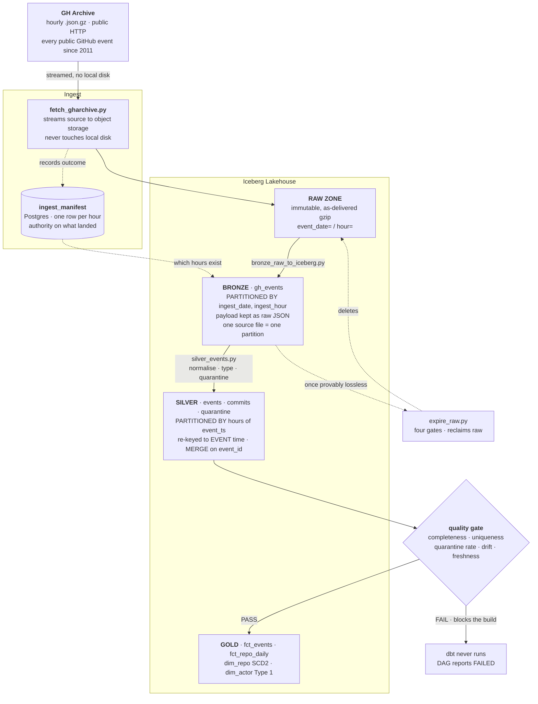
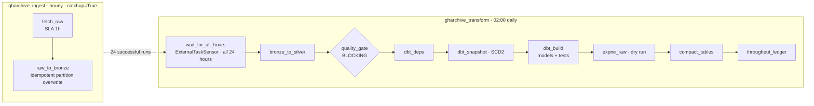

# GitHub Events Lakehouse

**Incremental lakehouse over the public GitHub event stream.** Apache Iceberg
on object storage, PySpark for ingest and normalisation, dbt on Trino for the
dimensional layer, Airflow for orchestration, with a blocking data-quality
gate and documented service levels.

`Apache Iceberg` · `PySpark` · `dbt` · `Trino` · `Airflow` · `S3` · `Postgres`

> Cut a 24-hour backfill from an out-of-memory failure to **8m14s** by
> diagnosing an O(n²) merge as a partition-pruning problem — after three
> rounds of memory tuning had failed to fix it.

This is a **data engineering** project. There is no model in it, by design.
The interesting problems here are schema evolution, idempotent reprocessing,
partition design, late-arriving data, and knowing what your pipeline costs.

**Everything below was measured, not estimated.** The reports in
[`docs/_measured/`](docs/_measured/) are generated by `make` targets against
real data and committed, so every number here can be checked.

---

## At a glance

| | |
|---|---|
| **Events processed** | 3,828,156 across a complete 24-hour day |
| **Backfill** | 24 Airflow DAG runs · 48 tasks · 0 failures · 14 min |
| **Silver build** | 3.8M events in **8m14s**, per-hour cost flat to the end |
| **Tests** | **33/33** dbt tests green, including two SCD2 integrity assertions |
| **Idempotency** | Byte-identical checksums across two passes, new Iceberg snapshot |
| **Quality drill** | 1,000 of 1,500 injected defects quarantined, gate fired |
| **Defects found** | ~20 real bugs, essentially all invisible without running it |

---

## Architecture



<details>
<summary><b>Why each layer is partitioned the way it is</b> — the decision I'd most want to defend</summary>

<br/>

**Bronze is partitioned by *ingest* time. Silver by *event* time.**

An hourly source file for hour 14 contains events whose `created_at` spills
into hours 13 and 15. If bronze were partitioned by event time, "reprocess
just this one file" would be impossible to do atomically — you would be
touching three event-time partitions and could not distinguish your rows from
the neighbouring file's.

Partitioning on *where the data came from* makes one source file map to
exactly one partition, so Iceberg's `overwritePartitions()` replaces precisely
that file's rows in a single atomic commit. Silver then re-keys to event time
with a `MERGE`, which also absorbs late arrivals.

**Cost:** a second pass and a merge. Worth it for atomic per-file redo.

**Silver uses `hours(event_ts)`, not `days(event_ts)`.** The partition grain
has to match the *batch* grain. Silver is merged one hour at a time; against a
day-grained target every merge rescanned the whole day. See
[the quadratic merge bug](#bugs-found-by-running-it) below.

</details>

### Orchestration



The hourly DAG **is** the backfill mechanism — `catchup=True`, no separate
code path. A pipeline with different logic for backfill than for steady state
has two pipelines, and one of them is always broken.

<details>
<summary><b>Why the gate is blocking, and why every tail task is <code>all_success</code></b></summary>

<br/>

The gate runs **before** dbt. A gate that runs after the gold build tells you
that you have already published bad numbers.

Every downstream task uses `trigger_rule="all_success"`. This matters more
than it looks: `compact_tables` and `throughput_ledger` originally used
`all_done`, so they ran *even when the completeness sensor had failed* — and
because they are the DAG's leaf tasks, their success marked the whole run
**green** while silver, the gate and dbt had never executed.

A pipeline that reports success after its gate failed is worse than no
pipeline: it lies to whatever is watching it.

The original intent — "a compaction failure should not fail the data
pipeline" — is a statement about *that task* failing, not a licence to run
after upstream failed. Retries cover the first. `all_done` silently buys
the second.

**Verified:** a failing gate now produces seven `upstream_failed` tasks and a
`FAILED` DagRun.

</details>

---

## Quickstart

Requires Docker Desktop running. **Give Docker at least 11 GiB** — Spark and
Trino both resident at 24-hour scale will not fit in less.

```bash
cp .env.example .env     # adjust GHA_START / GHA_END for the slice you want
make up                  # Postgres, SeaweedFS (S3), Trino, Airflow
make smoke               # VALIDATE THE STACK FIRST: Spark -> Iceberg -> S3
make profile             # measure the dataset -> docs/_measured/
make all                 # ingest -> bronze -> silver -> dbt -> gate
```

`make smoke` is not ceremony. It separates "the stack is misconfigured" from
"my pipeline logic is wrong", which otherwise fail identically — a missing jar
and a bad predicate both just produce a stack trace.

| Service | URL | Credentials |
|---|---|---|
| Airflow | http://localhost:8085 | `admin` / `admin` |
| Trino | http://localhost:8080 | none (local only) |
| S3 (SeaweedFS) | http://localhost:8333 · UI :9333 | see `.env` |

**Backfill a day** — the same code path as steady state:

```bash
docker compose exec -T airflow-scheduler \
  airflow dags backfill -s 2023-06-15T00:00:00 -e 2023-06-15T23:00:00 gharchive_ingest
```

> **Use `airflow dags backfill`, never `airflow dags test`**, for anything
> date-sensitive. `dags test` does not reproduce scheduled interval semantics
> and cost three separate debugging detours here. See
> [the bug list](#bugs-found-by-running-it).

`make help` lists every target. `make nuke` deletes all data and metadata.

---

## The dataset

Every public GitHub event since 2011-02-12, published hourly as gzipped
newline-delimited JSON at `https://data.gharchive.org/YYYY-MM-DD-H.json.gz`
(the hour is **not** zero-padded).

**Measured**, 2023-06-15 ([full profile](docs/_measured/dataset_profile.md)):

| Hour | Events | Gzipped | Uncompressed |
|---|---|---|---|
| 00:00 | 145,538 | 62.0 MB | 476.3 MB |
| 01:00 | 151,166 | 62.7 MB | 465.0 MB |
| 02:00 | 151,981 | 60.2 MB | 453.5 MB |

<details>
<summary><b>The recent feed is degraded — use historical dates</b></summary>

<br/>

Two hours measured three years apart:

| | 2023-06-15 12:00 | 2026-11-01 12:00 |
|---|---|---|
| Events | **198,897** | **4,720** |
| Gzipped | 90.7 MB | 5.8 MB |
| `PushEvent` share | **61.9%** | **absent entirely** |
| `CreateEvent` | 11.6% | absent |

`PushEvent`, `CreateEvent` and `DeleteEvent` — together the majority of the
historical stream — do not appear in the 2026 data at all. Volume is down
roughly 42× by event count.

The default range in `.env` is historical for this reason. On recent data
`silver.commits` would be empty and `commit_count` null throughout.

</details>

<details>
<summary><b>Source quirks that silently produce wrong numbers</b></summary>

<br/>

Each of these is a property of the source, not a bug — and each is a wrong
metric waiting to happen.

**1. `PushEvent.commits` is truncated at exactly 20.** Measured on hour 00
(89,273 pushes):

| Measure | Value |
|---|---|
| True commits, `sum(payload.size)` | 244,660 |
| Rows in `silver.commits` | 135,475 |
| **Undercount** | **109,185 — 44.63%** |
| Largest push | 1,000 commits → **20 rows** retrieved |

The cap of 20 is empirical, not documented. `fct_events.commit_count` carries
the true total from `payload.size`. Treat `silver.commits` as a **sample**,
never a census.

**2. `WatchEvent` means *starred*, not watching.** Exposed as `is_star`.

**3. The source emits duplicate events.** 48 duplicate `event_id`s in
3,828,156 rows, each appearing twice, all *within a single hourly file*.
Bronze preserves them (faithful to source); silver dedupes; the uniqueness
test passes. That split is the bronze/silver contract working.

**4. Hours are genuinely missing upstream.** Recorded as `missing_upstream`,
never as failures. A dip in `fct_repo_daily` may be a real source gap — check
the manifest before investigating the pipeline.

**5. The source format changed on 2015-01-01.** Rows carry `source_format`
(`v3` | `legacy`).

**6. Timestamps are UTC.** Any "commits by hour of day" analysis measures UTC
and will mis-attribute contributor working hours across time zones.

</details>

---

## Evidence

Claims in this repo are backed by generated reports, not assertions.

| Report | Generated by | Shows |
|---|---|---|
| [`dataset_profile.md`](docs/_measured/dataset_profile.md) | `make profile` | Measured volumes, compression, event-type mix |
| [`idempotency.md`](docs/_measured/idempotency.md) | `make idempotency` | Same range twice: identical data, new snapshot |
| [`partitioning_benchmark.md`](docs/_measured/partitioning_benchmark.md) | `make benchmark` | Three layouts, files pruned, wall time |
| [`compaction_*.md`](docs/_measured/) | `make compact` | File count/size before and after |
| [`quality_report.md`](docs/_measured/quality_report.md) | `make quality` | Every check, severity and result |
| [`retention.md`](docs/_measured/retention.md) | `make expire-raw` | Which raw hours are redundant, and why the rest were kept |
| [`throughput.md`](docs/_measured/throughput.md) | `make throughput` | Bytes processed vs retained, and which claims that supports |
| [`incident-postmortem.md`](docs/incident-postmortem.md) | `make incident` | A deliberate corruption drill, what the gate caught, what it missed |

<details>
<summary><b>Idempotency, proven by checksum</b></summary>

<br/>

`bronze_raw_to_iceberg.py` run twice over the same range, no intervening
change:

| Measure | Pass 1 | Pass 2 | |
|---|---|---|---|
| rows | 848,106 | 848,106 | identical |
| distinct_ids | 848,098 | 848,098 | identical |
| id_checksum | 1820951212451167 | 1820951212451167 | **identical** |
| payload_bytes | 2,437,894,013 | 2,437,894,013 | identical |
| snapshot_id | 8351113072006379267 | 3576205085657635040 | **changed** |

Byte-identical data under a **new** Iceberg commit is exactly what correct
partition-overwrite looks like. A new snapshot id is not drift — it is the
second write being a second commit, with the pre-reprocess state still
queryable for the retention window.

</details>

<details>
<summary><b>The corruption drill, and why it initially tested nothing</b></summary>

<br/>

`make incident` injects defects, runs silver and the gate, writes a
postmortem, then cleans up. Current result: **1,000 of 1,500 injected rows
quarantined, gate fired.**

The 1,000-of-1,500 is exactly 4 of every 6 defects — the other 2 are a
deliberate duplicate pair, which are *valid* rows that dedupe rather than
quarantine. Every row is accounted for.

Getting there took two fixes to the drill itself:

- **It was vacuous.** Defects were written to sentinel partition
  `ingest_hour = 99`, chosen so cleanup was one safe partition delete — but
  silver reads `ingest_hour = <hour being processed>` and never looked at
  hour 99. Nothing was quarantined, the gate never fired, and the drill
  reported a failure that was entirely an artefact of its own design. **A
  test the pipeline cannot see tests nothing.** Now injects into the real
  partition, tagged `source_file` for surgical cleanup.
- **Six bad rows in 145k is 0.004%**, far below the 0.5% quarantine
  threshold, so the gate correctly stayed silent. A handful of bad rows
  *should not* page anyone. The drill now replicates defects to cross the
  threshold, and asserts containment and gate-firing **separately**, since
  those break for different reasons.

</details>

<details>
<summary><b>Compaction: where it helps, and where it is a no-op</b></summary>

<br/>

| Table | Partitioning | Before | After |
|---|---|---|---|
| `bronze.gh_events` | ingest_date, ingest_hour | 6 files, avg 46.8 MB | **unchanged — 0 rewritten** |
| `silver.events` | event time | 6 files, avg 3.8 MB | 1 file, 25.7 MB |
| `silver.commits` | event time | 6 files, avg 9.1 MB | 1 file, 56.6 MB |

**Bronze has nothing to compact, by construction.** One source file maps to
one partition, so every partition already holds one correctly-sized file. The
small-file problem arises where many writes land in the same partition. The
job correctly does nothing.

**Compaction grew total bytes** (+13% on events, +4% on commits). That is the
trade: it optimises **read planning** — one file footer to open instead of
six — not storage size. Per-hour files had better encoding locality than the
merged file. Record counts are asserted identical; the job fails if they move.

</details>

---

## Engineering decisions

<details>
<summary><b>Storage &amp; layering</b> — Iceberg, raw payloads, quarantine</summary>

<br/>

| Decision | Why | What it cost |
|---|---|---|
| **Iceberg over plain Parquet** | Schema evolution without rewriting, hidden partitioning so queries don't hardcode layout, snapshot isolation, and time travel for "what did this look like before the backfill". | A catalog is now a dependency, and table maintenance is a job you have to run. |
| **`payload` stored as a raw JSON string in bronze** | Its shape differs per event type and has changed over the years. Typing it at ingest means rewriting bronze whenever the source adds an event type; typing it in silver is a cheap re-derive from data already held. | Silver cannot be a trivial `SELECT *`; parsing is real work. |
| **Partition values parsed from the file path, not the event body** | A row with a garbage `created_at` still lands in the right partition. Deriving partitions from the payload lets one corrupt timestamp scatter rows into partitions you never reprocess. | None. |
| **Quarantine table instead of dropping bad rows** | The payload is retained, so a parser fix can replay without re-ingesting. Silently dropping rows is how a dashboard is quietly wrong for a year. | An extra table to monitor; quarantine can itself grow unnoticed. |
| **`unmapped_keys` on every bronze row** | Records any top-level source key the schema does **not** persist. While non-empty, bronze is not a lossless re-encoding and raw expiry is refused. | Discarding a field now requires an explicit, recorded decision. |

</details>

<details>
<summary><b>Modelling</b> — SCD2, merge keys, incremental strategy</summary>

<br/>

| Decision | Why | What it cost |
|---|---|---|
| **`MERGE` on `event_id` in silver** | Globally unique at source, so the merge is exactly-once regardless of how many times a range is reprocessed, and late events land in the correct event-time partition. | Costlier than append; needs a bounded lookback to stay affordable. |
| **`dim_repo` as SCD Type 2** | Repos get renamed and transferred, and the event log records the name *as it was*. Type 1 would rewrite history — last month's commits appearing under this month's name, and "who owned this when the incident happened" becomes unanswerable. | Every fact join needs a validity-window predicate, which is easy to get wrong. Hence two singular tests. |
| **`dim_actor` as Type 1, documented** | The event stream carries no reliable account-rename signal, so a Type 2 actor dimension would be *invented data*. | None — but it must be written down, or someone "fixes" it later. |
| **Bounded 3-day incremental lookback** | A full rescan every run is the commonest way dbt projects get expensive. The window still catches late arrivals. | Events later than 3 days need an explicit reprocess. The contract states this. |
| **`accepted_values` test on `event_type`** | If the source ships a new event type the test *fails* and a human decides what it means, rather than it silently joining an "other" bucket nobody looks at. | A new event type breaks the build until someone acts. That is the intent. |

</details>

<details>
<summary><b>Orchestration &amp; operations</b></summary>

<br/>

| Decision | Why |
|---|---|
| **The hourly DAG with `catchup=True` *is* the backfill** | No separate script. Different code paths for backfill and steady state means two pipelines, and one is always broken. |
| **Two DAGs on two schedules** | Ingest cadence is set by the source; transform cadence by consumers. Coupling them means a change to one forces a change to the other. |
| **`ExternalTaskSensor` on all 24 hours** | A partially-ingested day produces a partial daily rollup that looks *exactly* like a real one. |
| **Sensor in `poke`, not `reschedule`** | `reschedule` is the better production default, but as a DAG's first task it **dead-locks `airflow dags backfill`**. For a project whose central claim is one code path for backfill and steady state, a gate that deadlocks backfill is not a gate. |
| **`max_active_runs=1`** | Not conservatism — a hard constraint. Spark runs in local mode *inside* the scheduler container, so four concurrent runs would mean ~8 GB of driver heap in a 3 GB cgroup. Raising it is only safe once Spark submits to a cluster. |
| **Tail tasks `all_success`, never `all_done`** | `all_done` made a failed gate report success. See above. |

</details>

---

## Bugs found by running it

The most useful part of this repo. ~20 real defects, essentially all invisible
without execution. The five worth reading:

<details>
<summary><b>1. A failed gate reported SUCCESS</b> — the worst bug in the project</summary>

<br/>

`compact_tables` and `throughput_ledger` carried `trigger_rule="all_done"`, so
they ran even when the completeness sensor had failed. Because they are the
DAG's leaf tasks, their success marked the whole DagRun **green** — while
silver, the quality gate and dbt had never executed.

Monitoring would have shown a healthy pipeline that transformed nothing.

The reasoning error is subtle and worth being able to state: *"a compaction
failure should not fail the data pipeline"* is a claim about **that task**
failing, not permission to run after upstream has failed. Retries cover the
first; `all_done` silently buys the second.

**Fix:** `all_success` on every tail task. **Verified:** gate failure now
yields seven `upstream_failed` tasks and a `FAILED` DagRun.

</details>

<details>
<summary><b>2. The merge key carried no partition information</b> — O(n²) backfill</summary>

<br/>

Silver merged on `event_id` alone. `event_id` carries no partition
information, so Iceberg had nothing to prune on and **every hourly merge
full-scanned the entire accumulated target.** At 6 and 12 hours this was
merely slow; at 24 it was quadratic and OOM-killed the driver.

I spent three rounds tuning heap size and parallelism first. Each "fix" just
moved where it died — which is itself the lesson: **OOM is a symptom, and
tuning memory to fix an O(n²) cost only relocates the failure.**

**Fix, two parts:**
1. Align the partition grain with the batch grain — `hours(event_ts)` rather
   than `days(event_ts)`. Day-level queries still prune, since Iceberg's
   `hours()` transform satisfies a date predicate across that day's 24
   partitions.
2. Add an event-time bound to the merge `ON` clause so pruning is possible
   at all.

**Result:** 24 hours went from OOM-death to **8m14s**, with per-hour cost
**flat to the end** — hour 24 took 14 seconds, the same as hour 1.

</details>

<details>
<summary><b>3. Bronze crashed on a missing hour</b> — the failure this project advertises surviving</summary>

<br/>

The code comment claimed *"missing hours are expected; let Spark skip them
rather than failing the batch."* That was aspiration, not behaviour:
`spark.read.text()` raises `PATH_NOT_FOUND` on a nonexistent path. Any
backfill crossing a GH Archive gap — or an hour whose raw object had been
expired — would have crashed.

**Fix:** the `ingest_manifest` is now the authority on which hours exist, so
bronze reads only hours that actually landed. Verified against a real
expiry: `WARNING skipping 1 hour(s) absent from the raw zone` and the batch
continued.

The manifest went from observability to load-bearing.

</details>

<details>
<summary><b>4. Four tests that were wrong about their own subject</b></summary>

<br/>

A recurring and instructive pattern. **The tell is always an incoherent
result**, not an obviously broken one.

- **The idempotency proof** asserted `rows == distinct_ids` alongside "no
  drift", and failed with an **empty drift dict** — data provably unchanged,
  yet reported NOT idempotent. It asserted uniqueness in bronze, which
  contradicts the project's own layer contract: bronze reproduces the source
  *including* its duplicates; silver dedupes.
- **The corruption drill** was invisible to the pipeline (sentinel partition).
- **The "future-dated" defect** used `data_hour + 365 days`, which against
  2023 data produced 2024 — the past. Silver correctly ignored it. A test for
  future-dated data has to be future-dated at *run* time.
- **A sensor "fix"** was made on misleading `dags test` evidence and reverted
  after a backfill showed the original was correct.

</details>

<details>
<summary><b>5. <code>airflow dags test</code> does not reproduce scheduled semantics</b></summary>

<br/>

Three separate detours before this was clear:

1. It gave the hourly DAG a **shifted interval** (logical 08:00 →
   `data_interval_start` 07:00), prompting a "fix" to a sensor that was
   already correct.
2. A DagRun it created kept its **stale interval through
   `--reset-dagruns`**, so a 24-hour backfill silently reprocessed hour 07
   twice and never fetched hour 08 — while reporting all 24 runs successful.
3. It handed the transform DAG a date **two days off**, failing the quality
   gate on a day that was never ingested.

**Use `airflow dags backfill` for anything date-sensitive.** It applies the
real timetable. Recorded in both DAGs.

</details>

<details>
<summary><b>Also found and fixed</b></summary>

<br/>

- **MinIO withdrawn from Docker Hub** (`minio/minio` 404s, quay.io won't list
  tags anonymously) → SeaweedFS, adopted only after smoke-testing
  `mb`/`put`/`ls`/`get` and restart persistence. LocalStack rejected: S3
  persistence is a paid feature, so the raw zone would not survive `make down`.
- **Spark could not start a JVM.** The Ivy cache volume initialised
  root-owned while the container runs as uid 50000. Fixed by creating the
  directory with correct ownership at build time, which a fresh named volume
  inherits.
- **Trino would not create the JDBC catalog's metadata tables**, unlike
  Spark's `JdbcCatalog`, so every Trino query failed until a Spark job
  happened to run first. The DDL is now created at database init — captured
  from `information_schema` after Iceberg generated it, not written from
  documentation.
- **Trino OOM-killed twice.** `-XX:MaxRAMPercentage=80` of an *unbounded*
  container claimed 6.2 of 7.65 GiB. A 2.5 GiB cap did not help either: a
  percentage *of the cap* cannot leave room for the non-heap memory living
  inside that same cap. Heap pinned at 2G with 4G of container.
- **`local[*]` ran ~8 tasks concurrently inside one driver JVM**, each holding
  sort-merge spill buffers. Capped to `local[2]`.
- **The SCD2 snapshot had duplicate source rows** — `unique_key='repo_id'`
  while grouping by `repo_id, repo_name, org_login`. 82 of 64,966 repos
  appeared under multiple name/org combinations in a single hour.
- **Fixing that query was not enough.** dbt's *initial* snapshot is a
  `CREATE TABLE AS`, which had silently accepted the duplicates; only later
  merges fail. The dimension had to be dropped and rebuilt — the operational
  half of the lesson, and the more useful half.
- **The sensor anchored on `dt`**, but this DAG's cron is `0 2 * * *`, so `dt`
  is 02:00. It would have missed hours 00–01 of the day it guards while
  demanding two hours of the following day.

</details>

---

## Retention: processing volume ≠ storage footprint

The ingest path never writes to local disk, so **disk constrains what you
retain, not what you process.**

**Measured**, one hour (62 MB gzipped source, 145,538 events):

| Layer | On disk | Share of retained |
|---|---|---|
| `bronze.gh_events` | 44.4 MB | **77%** |
| `silver.commits` | 9.7 MB | 17% |
| `silver.events` | **3.9 MB** | 7% |

`silver.events` is **~15× smaller** than the compressed source for the same
rows. But total retention is 93.5% of source volume, because bronze keeps
`payload` whole — a deliberate choice that buys replayability, and the reason
the headline ratio looks unimpressive.

**So the levers rank:** expiring raw frees 62 of 120 MB, but **bronze, not
raw, is the larger remaining target.** Tiering it — keep `payload_json` hot
for N days, then drop the column and rely on silver — is the real saving at
scale, and the real trade, since it ends unlimited replay.

<details>
<summary><b>Raw expiry is gated, not scheduled</b></summary>

<br/>

| Target | Command |
|---|---|
| See what could be expired, and why not | `make expire-raw` (dry run) |
| Actually reclaim the bytes | `make expire-raw-apply` |
| The bytes-processed ledger | `make throughput` |

Four gates must all hold before an object is deleted:

1. **Age** — older than `--min-age-hours`. A bug found tomorrow should still
   be fixable from source.
2. **Bronze coverage** — rows exist whose `source_file` is that object.
3. **Silver coverage** — the hour cleared normalisation and the gate.
4. **Losslessness** — no row reports an unmapped top-level key.

Gate 4 is the one that matters. While `unmapped_keys` is non-empty, bronze is
**not** a lossless re-encoding, raw is still the only copy of something, and
expiry is refused. Discarding a field requires an explicit `--discard-keys`
argument, recorded in the report.

**Proven:** 62.0 MB reclaimed, 0 refused. The manifest row became
`status=raw_expired` while **retaining `size_bytes`** — so the
bytes-processed ledger outlives the data it describes. Bronze still held that
hour's 145,538 rows: the data outlived its source, which is the entire point.

In production this would be an S3 Lifecycle rule. The explicit job exists
because a lifecycle rule expires on **age alone**, with no idea whether
anything downstream captured the data.

</details>

---

## Cost, and scaling

<details>
<summary><b>What this would cost on real infrastructure</b></summary>

<br/>

The local stack costs nothing. The model, rather than a stale number:

```
monthly_storage = raw_gb * $/GB-month + lakehouse_gb * $/GB-month
monthly_compute = dpu_hours_per_day * 30 * $/DPU-hour
monthly_query   = tb_scanned_per_month * $/TB
```

Fill the volumes from `make profile` and the Iceberg `files` metadata tables;
fill the rates from current cloud pricing when you write it up. **Do not copy
rates from a blog post** — they go stale and an interviewer may know the
current ones.

Levers that actually move the total, in order of impact:

1. **Partition pruning** — query cost is bytes scanned.
2. **File size** — small files inflate request counts and planning time.
3. **Compression** — zstd over snappy.
4. **Snapshot expiry** — time travel is not free; 7-day retention is a
   deliberate trade against unlimited rollback.
5. **Bounded incremental lookback** — 3 days, not a full rescan.

</details>

<details>
<summary><b>If this had to run 100× bigger</b></summary>

<br/>

Several choices here are laptop choices and would change.

- **Replace Spark-in-local-mode** with EMR, Dataproc or Databricks. The
  `max_active_runs=1` constraint exists purely because Spark runs inside the
  scheduler.
- **Replace the JDBC catalog** with a managed one (Glue, Unity, Polaris). A
  single Postgres as the catalog is a single point of failure.
- **Fan out the ingest.** Per-hour HTTP fetching does not scale to a parallel
  multi-year backfill; it becomes independent tasks, which the hourly DAG
  structure already supports. A Lambda fan-out lands a month in minutes.
- **Reconsider MERGE.** Copy-on-write versus merge-on-read becomes a real
  decision driven by the read/write ratio.
- **Add a streaming path.** The same source replayed through Kafka with
  watermarking would serve a freshness SLA in minutes rather than daily.
  Deliberately out of scope: the batch path had to be correct first.

</details>

---

## Limitations

Stated plainly, because a project claiming none is not credible.

- **Scale is modest.** 3.8M events, ~1.5 GB. Single node, Spark in local
  mode. Shuffle behaviour, skew and executor tuning are not exercised.
- **The host is the performance constraint, not the code.** `local[2]` costs
  ~5.7× against `local[*]` — the price of not being OOM-killed — and the
  stack's steady footprint grows with data volume. A 16 GiB Mac with Docker
  limited to 7.65 GiB went into swap mid-run and turned a 512-second pass
  into 6,483 seconds. **Correctness results survived that; performance
  results did not.** Every timing here is host-bound.
- **The transform DAG's final dbt stage is unproven end-to-end** at 24-hour
  scale. Sensor, silver and the quality gate all pass; `dbt_snapshot` then
  fails because Trino and the Spark driver are both OOM-killed. Spark's 3 GiB
  and Trino's 4 GiB caps cannot both be honoured in a 7.65 GiB VM. The same
  dbt models build 33/33 green when run without that contention. **Give
  Docker 11+ GiB.**
- **No streaming layer.** See above.
- **No alerting.** The gate fails the DAG and writes a report; nothing pages
  anyone.
- **Image tags.** `seaweedfs` and `aws-cli` track `latest`. Pin them before
  calling this reproducible.

---

## Repo layout

```
ingest/     fetch_gharchive.py   idempotent downloader + manifest
            profile_slice.py     measures the dataset
            common.py            config, S3, manifest helpers
spark/jobs/ session.py           SparkSession wired to Iceberg + S3
            bronze_raw_to_iceberg.py
            silver_events.py     normalisation, typing, quarantine, MERGE
            compaction.py        rewrite files, expire snapshots
            expire_raw.py        four-gate raw expiry
dbt/        models/staging       thin views over silver
            models/gold          star schema, incremental merge
            snapshots            SCD2 repo dimension
            tests                singular SCD2 integrity assertions
airflow/dags/
            gharchive_ingest.py     hourly, catchup=True == the backfill
            gharchive_transform.py  daily, gated on completeness
tests/      smoke_stack.py       8-step stack validation. Run this first.
            quality_gate.py      the blocking gate
            prove_idempotency.py evidence, not assertion
            benchmark_layout.py  partition design, measured
            inject_incident.py   corruption drill + postmortem
            report_throughput.py bytes-processed ledger
docs/       data-contract.md     guarantees, SLAs, source gotchas
            _measured/           generated reports, committed
conf/       trino/, postgres/    service configuration
```

---

## Data contract

Consumer-facing guarantees, SLAs, breaking-change policy and the full list of
source gotchas live in **[`docs/data-contract.md`](docs/data-contract.md)**.

The join every consumer gets wrong — facts to the dimension **as it was at
the time of the event**:

```sql
SELECT f.event_id, d.repo_name, d.org_login
FROM gold.fct_events f
JOIN gold.dim_repo  d
  ON  f.repo_id  = d.repo_id
  AND f.event_ts >= d.valid_from
  AND f.event_ts <  d.valid_to
WHERE f.event_date = DATE '2023-06-15';
```

Joining on `is_current` instead gives you today's name attached to last
year's events. That is sometimes what you want. It is usually a bug.

---

## Source and attribution

Data from [GH Archive](https://www.gharchive.org/), which publishes the public
GitHub timeline. Check the terms on that site before redistributing any of it;
this repo stores no data.
